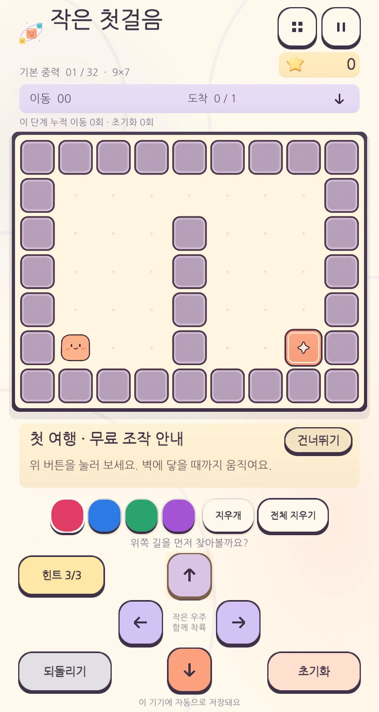

# 데굴데굴 퍼즐

**방향을 입력하면 친구들이 함께 움직입니다. 각 친구를 같은 색 목표로 보내는 중력 퍼즐 게임입니다.**

1인 개발 · itch.io 공개 · 중력 퍼즐 · Unity 6000.3.10f1 · C#

[Windows 실행 파일](https://github.com/lde0707/portfolio-game-builds/releases/tag/deguldegul-2026-11-14) · [QA 엑셀](https://leedoeon.vercel.app/qa/reports/degul-degul.xlsx) · [QA 포트폴리오](https://leedoeon.vercel.app/qa/index.html)

## 내가 맡은 역할

기획·게임 구현·테스트·itch.io 공개를 담당했습니다.

## 게임의 주요 흐름

홈 → 퍼즐 입력 → 완료·다음 단계 → 재실행

## 실행 방법

### Unity 없이 플레이

1. 위 **Windows 실행 파일** 링크에서 `DegulDegul-Windows-x64.zip`을 받습니다.
2. ZIP **전체를 압축 해제**합니다.
3. `DegulDegul.exe`를 실행합니다.

Windows 64비트용입니다. EXE와 `Data` 폴더·`UnityPlayer.dll`을 함께 유지하세요. GitHub의 `Source code` 압축 파일은 게임 실행 패키지가 아닙니다.

**기본 조작:** 방향키·WASD 이동 / Z 되돌리기 / R 초기화 / Esc 메뉴

[itch.io에서 브라우저로 플레이](https://lde0707.itch.io/degul-degul)

Unity에서 소스 열기

1. Unity Hub에서 `Android Puzzle` 폴더를 프로젝트로 추가합니다.
2. **Unity 6000.3.10f1**으로 엽니다.
3. `Assets/Scenes/GravityPrototype.unity` 씬을 열고 Play를 실행합니다.
4. 실행 파일을 만들 때 Windows Build Support를 설치하고 기존 Build Settings의 씬 구성으로 Windows x64를 빌드합니다.

## QA 테스트

Windows 빌드에 실제 키보드·마우스 입력을 보내 확인한 내용입니다. 세부 조건과 관찰값은 **QA 엑셀의 플레이 재검증 시트**에서 볼 수 있습니다.

| 확인 기능 | 테스트 조건 | 관찰 결과 |
|---|---|---|
| 이동·되돌리기·초기화 | 방향 이동 후 Z·R 입력 | 이동 복구와 초기화 확인창 표시 |
| 완료 판정·보상 | 첫 두 단계 완료 후 다음 단계 진입 | 단계 완료와 보상 증가 확인 |
| 저장·재실행 | 종료 후 다시 실행 | 획득 재화 유지 |

**검증 범위:** 전체 128개 단계와 모든 특수 기믹 완주는 이번 범위에서 제외했습니다.

[실제 입력 검증 기록](PLAYTEST.md) · [실행·검증 안내](PLAY.md)

## 소스와 상세 문서

- [퍼즐 게임 코드](Android%20Puzzle/Assets/Scripts/GravityPuzzle)
- [기존 개발·설계 기록](README-DEV-NOTES.md)
